<p align="center">
  
</p>

<h1 align="center">House Lights</h1>

<p align="center">
  An Apple Watch app that controls Philips Hue lights straight from the wrist,<br>
  over home Wi-Fi, with no iPhone, Hue account or cloud involved.
</p>

---

House Lights is a standalone app for the Apple Watch Ultra. It talks to the Hue Bridge's
local **CLIP API v2** over HTTPS on the home network, so it works with the iPhone left at
the office. Every room is a tile: tap to switch it, hold to open it, and turn the Digital
Crown to brighten or dim everything that's on. A Smart Stack widget and Siri use the same
logic.

It's a personal project, installed through TestFlight.

**Version 1.0** · watchOS 26 · SwiftUI, App Intents and WidgetKit · no third-party packages

## Contents

- [How it works](#how-it-works)
  - [Rooms grid](#rooms-grid)
  - [Room screen](#room-screen)
  - [Color wheel](#color-wheel)
  - [Defaults and temporary colors](#defaults-and-temporary-colors)
  - [Arrange](#arrange)
  - [Pairing with the bridge](#pairing-with-the-bridge)
  - [Bridge not reachable](#bridge-not-reachable)
  - [Bridge log](#bridge-log)
  - [Smart Stack widget](#smart-stack-widget)
  - [Siri](#siri)
- [How it talks to the bridge](#how-it-talks-to-the-bridge)
- [What's stored on the watch](#whats-stored-on-the-watch)
- [Building and running](#building-and-running)
- [Tests](#tests)
- [Project layout](#project-layout)
- [Known limits](#known-limits)

## How it works

### Rooms grid

The app opens on a grid with one tile per Hue room. A lit tile is filled with the room's
real color and shows its brightness; an off tile is dark gray and says **Off**. Icons come
from each room's Hue type (sofa, frying pan, bed, monitor, door…), with a bulb as the
fallback. Zones aren't shown.

<p>
  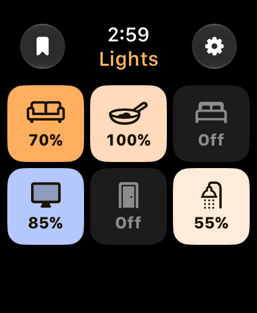
  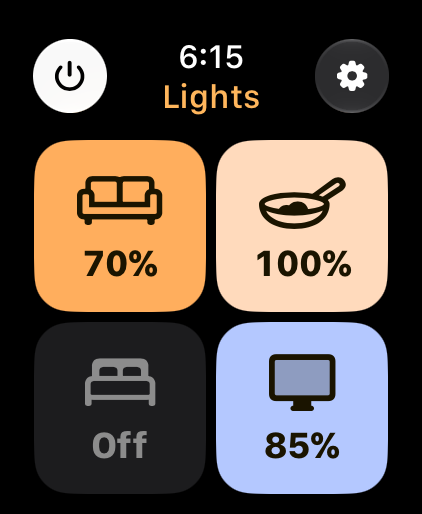
  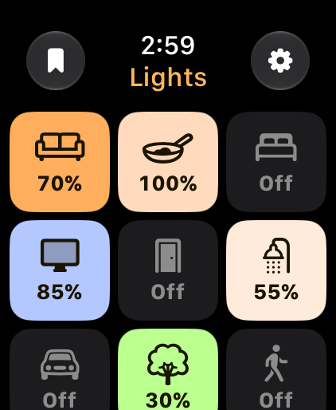
</p>

- **Tap** a tile to switch the room on or off. **Hold** it for half a second to open the
  room; a hold never also switches it.
- **Sizes:** 1–4 rooms are big tiles two across; 5–9 are three across; 10 or more are three
  across and scroll by dragging. Never four across.
- **Digital Crown:** each click adds or removes 5% on every room that's on, so their
  differences are kept (70% and 40% become 75% and 45%). Rooms stop at 100%; a room
  dimmed to 0% turns off, and a tap brings it back at 70%. A pill shows
  "Brighter · 4 on" while you turn. With 10+ rooms the Crown still only changes
  brightness.
- **All off** (left of the clock) turns every light off with one command; the gear (right
  of the clock) opens Settings.
- **Live:** changes made in the Hue app, with a switch or a remote show up within a second.

### Room screen

<p>
  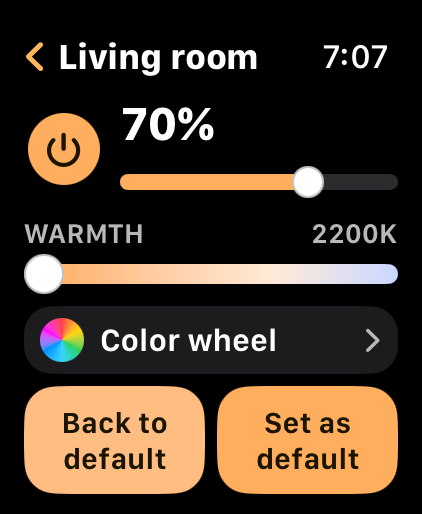
  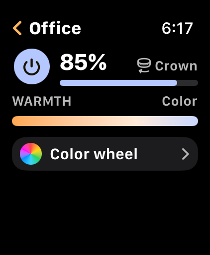
</p>

The power button switches the room. Drag the brightness bar, or turn the Crown in 5% steps;
**Warmth** slides from 2200 K to 6500 K. Changes reach the lights while you turn or drag (at
most once a second per room, which is what the bridge allows). Changing the color of a room
that's off doesn't turn it on; the new color shows when it's next switched on.

### Color wheel

<p>
  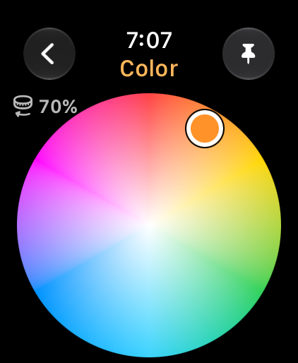
  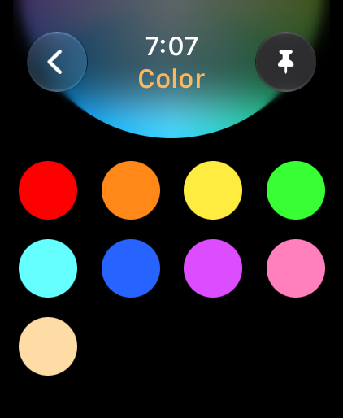
</p>

The largest wheel that fits, with the brightness readout in the corner (the Crown still
sets brightness here). The color is sent when your finger lifts, converted to Hue's CIE xy
coordinates and fitted to the colors the room's bulbs can show.

The **pin** button right of the clock saves the current color. Saved colors appear below
the wheel, four across; drag the page to scroll to them. Tap a swatch to use it in this
room, hold it to remove it. They're shared by every room.

### Defaults and temporary colors

Each room's default color is saved on the bridge as a scene called
**"House Lights – \<room\>"**, created from the room's current look the first time you
change its warmth or color, so it survives reinstalling the app. Any other color is
*temporary*: it stays through any number of off/on cycles, and the Room screen shows two
buttons: **Back to default** (filled with the default color) and **Set as default**
(filled with the current color). Back to default keeps the room's brightness; on a room
that's off, the default comes back the next time House Lights turns it on. A color changed
outside the app (the Hue app, a switch, a power cut) drops the temporary label.

### Arrange

<p>
  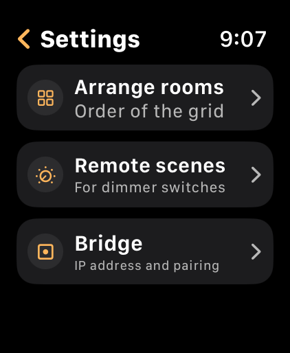
  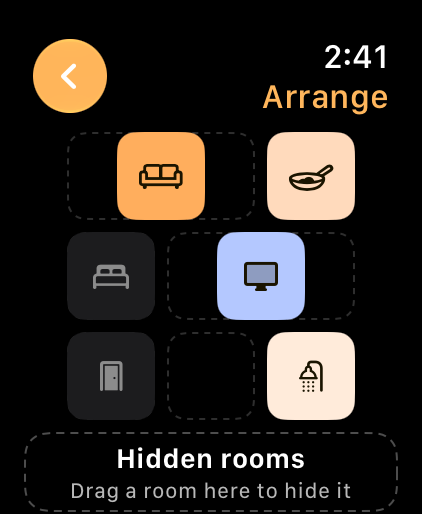
</p>

Settings › Arrange rooms shows the same grid in its current state. Drag a tile to move it;
nothing here changes the lights. The drag follows four rules so tiles never fight: the
finger is checked against fixed slot positions (never the moving tiles), a slot only
becomes the target from its middle 60%, the other tiles move aside after about 150 ms on a
new slot, and the order is saved on release. New rooms from the bridge go to the end. Back
from Settings or Arrange goes straight to the grid.

### Pairing with the bridge

<p>
  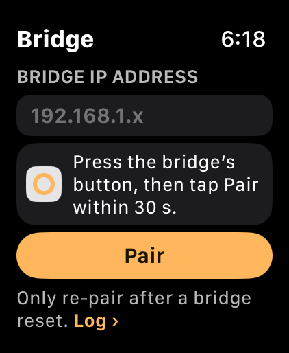
  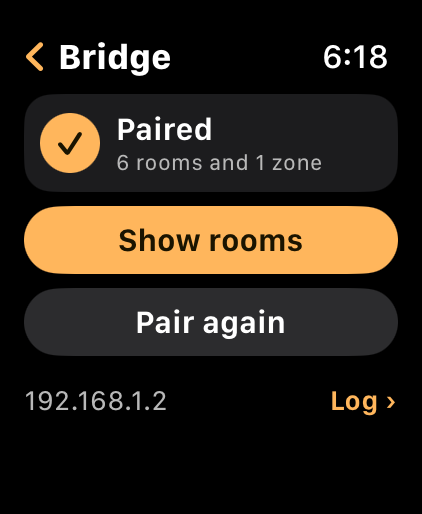
</p>

On first launch (and from Settings › Bridge): enter the bridge's IP address (reserve it in
your router — watchOS can't discover the bridge), press the round button on the bridge,
then tap **Pair** within 30 seconds. The app asks every 2 seconds until the bridge
answers, then shows how many rooms and zones it found.

### Bridge not reachable

<p>
  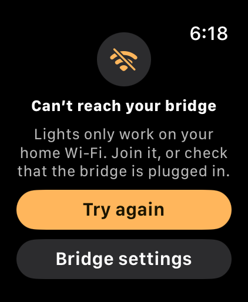
</p>

Shown whenever the bridge doesn't answer (watch not on home Wi-Fi, bridge unplugged), with
**Try again** and **Bridge settings**. A change the bridge refuses shows a short notice
instead.

### Bridge log

<p>
  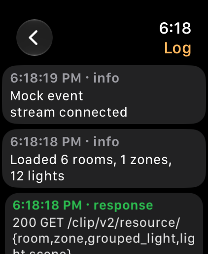
</p>

Settings › Bridge › Log › records every request, response code and error, newest first,
and survives relaunches — so a photo of it explains any problem at home.

### Smart Stack widget

<p>
  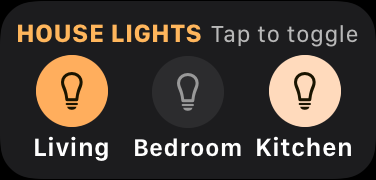
</p>

A rectangular widget with up to four round toggles in each room's color. Choose the rooms
by editing the widget on the watch. A tap switches the room without opening the app, then
the widget shows the bridge's new state; it doesn't poll.

### Siri

<p>
  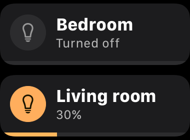
</p>

Rooms (and zones) are known to Siri by their Hue names:

- "Turn off the bedroom in House Lights" / "Turn on the living room in House Lights"
- "Set the living room in House Lights" — Siri then asks for the percentage
- "Set the living room warmth in House Lights" — Siri then asks for the kelvin

If the bridge can't be reached, Siri says so plainly.

## How it talks to the bridge

- **HTTPS with the bridge's own certificate.** Hue bridges use a certificate iOS doesn't
  trust, so a URLSession delegate accepts it only for the saved bridge IP, remembers the
  certificate seen at pairing, and refuses a different one later. Checks are never
  relaxed for anything else.
- **Pairing:** `POST /api` with `generateclientkey`; the application key goes in the
  Keychain.
- **Reading:** `room`, `zone`, `grouped_light`, `light` and `scene` resources.
- **Controlling:** rooms are switched through their `grouped_light`; "all off" uses the
  bridge's all-lights group. A per-room sender sends at most one command a second and only
  the latest value.
- **Live updates:** one `/eventstream/clip/v2` connection while the app is open,
  reconnecting if it drops. For two seconds after the app changes a room, the app's own
  state wins over the stream (the bridge echoes older and in-between states).
- **Nothing else:** no Hue account, cloud, analytics or location.

## What's stored on the watch

| What | Where |
| --- | --- |
| Bridge application key, pinned certificate hash | Keychain, shared with the widget |
| Bridge IP, grid order, temporary rooms, last-known room states | App Group defaults, shared with the widget |
| Room defaults | Scenes on the bridge, "House Lights – \<room\>" |
| Bridge log | App Group folder (`bridge-log.json`) |

## Building and running

Open `House Lights.xcodeproj` in Xcode 27 and run the **House Lights Watch App** scheme.
The simulator can't reach a Hue bridge, so it uses a **mock bridge** with six sample rooms
and a zone. Scripts use their own "House Lights Tests" simulator so they never disturb
the one you run from Xcode:

- `scripts/run.sh [shot.png] [launch args…]` builds, installs, launches and optionally
  screenshots.
- `scripts/shots.sh <dir> name "args" …` screenshots several states in one go.
- `scripts/test.sh` and `scripts/uitest.sh` run the unit and UI tests.

Debug launch arguments (simulator / debug builds):
`-mockTiles 12`, `-unpaired YES`, `-mockOffline YES`, `-mockTemporary YES`,
`-mockOutsideChanges YES`, `-realBridge YES`, `-openScreen settings|bridge|log|arrange|room|wheel`,
`-openRoom "Office"`.

### Releasing through TestFlight

Bump `CURRENT_PROJECT_VERSION` on every target, then run `scripts/release.sh`. It archives
for any watchOS device and uploads to App Store Connect for internal TestFlight testing,
using the Apple ID signed in to Xcode.

## Tests

- **104 unit tests** (Swift Testing, about 3 seconds): color maths and gamut clamping,
  command merging and the once-a-second sender, the event-stream parser, building the home
  from bridge-shaped JSON, pairing and certificate pinning, grid sizes, the Crown rules,
  the four Arrange drag rules, defaults and temporary colors, live sending while dragging,
  the settle window and reloads racing a tap, saved colors, Siri actions and the widget's
  rooms. Widget and Siri snapshots render
  to PNGs with `TEST_RUNNER_SNAPSHOT_DIR=… scripts/test.sh`.
- **9 UI tests** (XCTest, about 2 minutes): tap toggles, hold opens without toggling, the
  Crown on every screen (and never scrolling the big grid), a real Arrange drag, the
  temporary buttons appearing at once, pinning, scrolling to and removing a saved color, and
  Back going straight to the grid.

## Project layout

```
House Lights Watch App/   the app: Screens/ (Grid, Room, ColorWheel, Settings, Arrange,
                          Bridge, Shared), Model/ (AppModel and its extensions, Router,
                          layout and drag maths), Intents/ (Siri phrases), Support/
House Lights Widget/      the Smart Stack widget extension
Shared/                   built into both: Bridge/ (client, trust, sender, event stream,
                          log, mock), Models/, Storage/ (Keychain, App Group), Intents/,
                          Widget/ (the widget's view and configuration)
House Lights Watch AppTests/, House Lights Watch AppUITests/
Config/                   Info.plist additions and entitlements
mockups/                  the design mockups every screen was matched against
scripts/                  sim, run, shots, test, uitest, release
SPEC.md                   the spec; HOME-CHECKS.md lists what to check at home
```

## Known limits

- Works only on the home Wi-Fi with the bridge; away from home it shows Bridge not
  reachable.
- No individual-light control or scenes in the UI (v1 scope).
- Siri phrases can carry only one value (the room), so brightness and warmth are asked
  for after the phrase.
- A few Hue details can only be confirmed with the real bridge (room-level color
  commands, scene recall at a set brightness); see [HOME-CHECKS.md](HOME-CHECKS.md).
